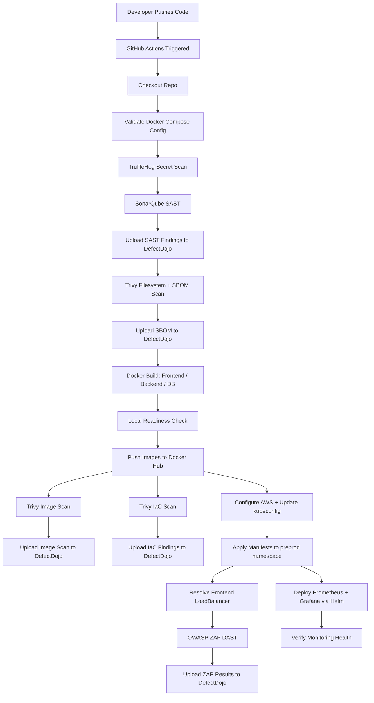

# AnzenOps

> **An end-to-end DevSecOps pipeline that secures a cloud-native application from code commit to production deployment on AWS EKS.**

AnzenOps is a practical, hands-on DevSecOps project that automates build, security scanning, deployment, and monitoring for a React + Flask + PostgreSQL application on AWS EKS. It demonstrates how security can be embedded directly into a CI/CD pipeline instead of being an afterthought.

---

## Badges


---

## Table of Contents

- [Overview](#overview)
- [Architecture](#architecture)
- [Tech Stack](#tech-stack)
- [Key Features](#key-features)
- [CI/CD Pipeline Flow](#cicd-pipeline-flow)
- [Security Workflow](#security-workflow)
- [Monitoring and Observability](#monitoring-and-observability)
- [Installation / Deployment](#installation--deployment)
- [Project Structure](#project-structure)
- [Current Architecture vs Future Plans](#current-architecture-vs-future-plans)
- [Future Improvements](#future-improvements)
- [Contributors](#contributors)

---

## Overview

Most CI/CD pipelines build and deploy fast, but leave security checks for later — which means secrets, vulnerable dependencies, and misconfigurations often reach production before anyone notices.

AnzenOps follows a **shift-left security** approach: every push is scanned for secrets, code issues, and vulnerabilities _before_ anything gets deployed.

In short, this project:

- Deploys a **React** frontend, **Flask** backend, and **PostgreSQL** database to **Kubernetes on AWS EKS**.
- Provisions all infrastructure with **Terraform** and configures supporting tools with **Ansible**.
- Runs every push through an automated **GitHub Actions** pipeline covering secret scanning, SAST, dependency/image scanning, and DAST.
- Centralizes every finding in **DefectDojo** for vulnerability management.
- Observes the running cluster with **Prometheus + Grafana**, with **Wazuh** available as optional runtime/node-level security monitoring.

---

## Architecture

**How it works, in plain terms:**

1. A push to GitHub triggers the GitHub Actions pipeline.
2. The code is scanned for secrets, code quality issues, and vulnerabilities before anything is built.
3. Docker images are built, scanned again, and pushed to Docker Hub.
4. Terraform-provisioned AWS EKS receives the deployment via Kubernetes manifests.
5. Once the app is live, OWASP ZAP scans it for runtime vulnerabilities.
6. All findings (SAST, SBOM, image scan, IaC, DAST) flow into DefectDojo, while Prometheus/Grafana (and optionally Wazuh) provide ongoing observability.

---

## Tech Stack

| Category                 | Technologies           |
| ------------------------ | ---------------------- |
| Frontend                 | React, Vite, Nginx     |
| Backend                  | Flask, Python          |
| Database                 | PostgreSQL             |
| Containerization         | Docker, Docker Compose |
| Cloud                    | AWS                    |
| Infrastructure as Code   | Terraform              |
| Configuration Management | Ansible                |
| Orchestration            | Kubernetes, AWS EKS    |
| CI/CD                    | GitHub Actions         |
| Container Registry       | Docker Hub             |
| Secret Scanning          | TruffleHog             |
| SAST / Code Quality      | SonarQube              |
| Vulnerability Scanning   | Trivy                  |
| DAST                     | OWASP ZAP              |
| Vulnerability Management | DefectDojo             |
| Runtime Security / SIEM  | Wazuh (optional)       |
| Monitoring               | Prometheus, Grafana    |

---

## Key Features

- ✅ Automated GitHub Actions CI/CD pipeline (build, scan, deploy, validate)
- ✅ Secret scanning with TruffleHog before every build
- ✅ Static Application Security Testing (SonarQube)
- ✅ Filesystem, IaC, SBOM, and container image scanning (Trivy)
- ✅ Docker-based packaging for frontend, backend, and database
- ✅ Docker Hub image publishing for Kubernetes deployments
- ✅ AWS EKS infrastructure provisioned entirely with Terraform
- ✅ Kubernetes manifests for preprod and production-style environments
- ✅ Dynamic Application Security Testing against the deployed frontend (OWASP ZAP)
- ✅ Centralized vulnerability management through DefectDojo
- ✅ EKS-based monitoring with Prometheus and Grafana
- ✅ Optional Wazuh manager + Kubernetes DaemonSet for node-level runtime monitoring
- ✅ Repeatable deployment and cleanup scripts for infra and Kubernetes

---

## CI/CD Pipeline Flow



<details>
<summary><strong>Full step-by-step breakdown (click to expand)</strong></summary>

1. **Checkout** — GitHub Actions checks out the repository.
2. **Validate config** — Docker and Docker Compose configuration is validated.
3. **Secret Scan — TruffleHog** — Repository is scanned for verified leaked secrets. _(Can fail the pipeline.)_
4. **SAST — SonarQube** — Static analysis and code-quality checks run against the codebase. _(Can fail the pipeline.)_
5. **DefectDojo upload** — SonarQube findings are exported and imported into DefectDojo.
6. **Trivy filesystem + SBOM** — Repository filesystem is scanned and an SBOM is generated. _(Can fail the pipeline.)_
7. **DefectDojo upload** — SBOM results are imported into DefectDojo.
8. **Docker build** — Database, backend, and frontend images are built via Docker Compose. _(Can fail the pipeline.)_
9. **Readiness check** — The app is started locally in the runner for a basic sanity check.
10. **Push to Docker Hub** — Images are pushed to the registry. _(Requires valid Docker Hub credentials — can fail the pipeline.)_
11. **Trivy image scan** — Published container images are scanned for vulnerabilities.
12. **DefectDojo upload** — Image scan results are imported into DefectDojo.
13. **Trivy IaC scan** — Terraform/Kubernetes configuration is scanned for misconfigurations.
14. **DefectDojo upload** — IaC findings are imported into DefectDojo.
15. **AWS auth + kubeconfig** — GitHub Actions authenticates to AWS and updates the EKS kubeconfig. _(Can fail the pipeline.)_
16. **Deploy** — Kubernetes manifests are applied to the `preprod` namespace. _(Can fail the pipeline.)_
17. **Resolve LoadBalancer** — The frontend's public endpoint is resolved.
18. **DAST — OWASP ZAP** — The live frontend is scanned for runtime vulnerabilities. _(Can fail the pipeline.)_
19. **DefectDojo upload** — ZAP results are uploaded as workflow artifacts and imported into DefectDojo.
20. **Monitoring deploy** — Prometheus and Grafana are deployed to EKS via Helm, when the required Grafana secret is present.
21. **Monitoring verification** — Cluster monitoring health is checked using the repository's verification script.
22. **Cleanup** — The preprod environment is torn down where the workflow stage requires it.

</details>

---

## Security Workflow

| Stage                     | Tool             | Purpose                                     |
| ------------------------- | ---------------- | ------------------------------------------- |
| Source Code               | TruffleHog       | Detect leaked secrets/credentials           |
| Source Code               | SonarQube        | SAST and code-quality analysis              |
| Dependencies / Filesystem | Trivy            | SBOM generation + vulnerability scanning    |
| Container Images          | Trivy            | Image vulnerability scanning                |
| Infrastructure Code       | Trivy            | IaC misconfiguration scanning               |
| Running Application       | OWASP ZAP        | Dynamic Application Security Testing (DAST) |
| All Findings              | DefectDojo       | Centralized vulnerability management        |
| Runtime / Nodes           | Wazuh (optional) | Host-based security monitoring on EKS nodes |

---

## Monitoring and Observability

```text
AWS EKS
   ↓
Prometheus  (collects cluster and application metrics)
   ↓
Grafana     (visualizes metrics on dashboards)
```

- **Prometheus + Grafana** are deployed to EKS via Helm and give visibility into cluster health and application metrics.
- **Wazuh** is provisioned separately as an EC2-hosted manager. An optional Kubernetes DaemonSet manifest lets Wazuh agents run on EKS nodes for host-based intrusion detection (FIM, log collection, rootcheck) — this is enabled only when node-level runtime monitoring is needed.

---

## Installation / Deployment

### Prerequisites

```text
AWS CLI
Terraform
kubectl
Docker
Docker Compose
Git
Helm
Ansible
GitHub CLI
```

### Clone Repository

```bash
git clone https://github.com/Siddhantkpatil/DevSecOps_CdacProject.git
cd DevSecOps_CdacProject
```

### Configure AWS

```bash
aws configure
```

### Provision Infrastructure

A wrapper script provisions EKS and the security tooling hosts, reads Terraform outputs, configures tooling via Ansible, and generates the Wazuh agent manifest from the current Wazuh public IP.

```bash
chmod +x provision_infrastructure.sh
./provision_infrastructure.sh
```

Or run Terraform directly:

```bash
cd infra/terraform/eks
terraform init
terraform plan
terraform apply
```

### Configure Kubernetes Access

```bash
aws eks update-kubeconfig --region <region> --name <cluster-name>
```

```bash
kubectl get nodes
kubectl get pods -A
```

### Deploy the Application

Preprod:

```bash
chmod +x deploy_preprod_k8s.sh
./deploy_preprod_k8s.sh
```

Production-style namespace:

```bash
chmod +x deploy_prod_k8s.sh
./deploy_prod_k8s.sh
```

### Deploy Monitoring

```bash
export GRAFANA_ADMIN_PASSWORD='<strong-password>'
chmod +x deploy_monitoring.sh
./deploy_monitoring.sh
```

```bash
chmod +x verify_monitoring.sh
./verify_monitoring.sh
```

### Optional: Deploy Wazuh Agent

Enable only when the Wazuh manager is ready to accept agents.

```bash
export WAZUH_PUBLIC_IP='<wazuh-manager-public-ip>'
chmod +x deploy_wazuh_agent.sh
./deploy_wazuh_agent.sh
```

<details>
<summary><strong>Required GitHub Actions Secrets (click to expand)</strong></summary>

| Secret                   | Purpose                                          |
| ------------------------ | ------------------------------------------------ |
| `AWS_ACCESS_KEY_ID`      | AWS authentication for CI/CD                     |
| `AWS_SECRET_ACCESS_KEY`  | AWS authentication for CI/CD                     |
| `AWS_REGION`             | AWS region for EKS and EC2 resources             |
| `DOCKERHUB_USERNAME`     | Docker Hub namespace/login                       |
| `DOCKERHUB_TOKEN`        | Docker Hub authentication token                  |
| `SONAR_TOKEN`            | SonarQube API token                              |
| `SONAR_HOST_URL`         | SonarQube server URL                             |
| `DEFECTDOJO_URL`         | DefectDojo server URL                            |
| `DEFECTDOJO_API_KEY`     | DefectDojo API token                             |
| `GRAFANA_ADMIN_PASSWORD` | Grafana admin password for monitoring deployment |
| `WAZUH_PUBLIC_IP`        | Optional Wazuh manager public IP                 |

Configure under `Settings > Secrets and variables > Actions`. Never commit these values to the repository.

</details>

---

## Project Structure

```text
AnzenOps/
├── Backend/
│   ├── app.py
│   ├── Dockerfile
│   └── requirements.txt
├── Frontend/
│   ├── Dockerfile
│   ├── nginx.conf
│   ├── package.json
│   └── src/
├── Database/
│   ├── Dockerfile
│   └── init.sql
├── infra/
│   ├── terraform/
│   │   ├── eks/
│   │   └── monitoring-security/
│   └── ansible/
├── k8s/
│   ├── preprod/
│   ├── prod/
│   ├── monitoring/
│   └── wazuh-agent-daemonset.yaml.tpl
├── .github/
│   └── workflows/
├── Document/
├── docker-compose.yml
├── provision_infrastructure.sh
├── deploy_preprod_k8s.sh
├── deploy_prod_k8s.sh
├── deploy_monitoring.sh
├── verify_monitoring.sh
├── destroy_infrastructure.sh
└── README.md
```

| Path                                   | Purpose                                                          |
| -------------------------------------- | ---------------------------------------------------------------- |
| `Backend/`                             | Flask API service and backend container definition               |
| `Frontend/`                            | React/Vite frontend served by Nginx                              |
| `Database/`                            | PostgreSQL image and initialization SQL                          |
| `infra/terraform/eks/`                 | AWS EKS, VPC, node group, and observability provisioning         |
| `infra/terraform/monitoring-security/` | EC2 provisioning for SonarQube, DefectDojo, and Wazuh            |
| `infra/ansible/`                       | Ansible playbooks for configuring security tooling hosts         |
| `k8s/preprod/`                         | Preprod Kubernetes manifests                                     |
| `k8s/prod/`                            | Production-style Kubernetes manifests                            |
| `k8s/monitoring/`                      | kube-prometheus-stack Helm values                                |
| `.github/workflows/`                   | GitHub Actions CI/CD and security workflows                      |
| `Document/`                            | Project notes, architecture material, and pipeline documentation |

---

## Current Architecture vs Future Plans

| Currently Implemented               | Planned Improvements                       |
| ----------------------------------- | ------------------------------------------ |
| GitHub Actions CI/CD                | Falco (runtime threat detection)           |
| AWS EKS via Terraform               | Argo CD (GitOps delivery)                  |
| TruffleHog secret scanning          | OPA/Gatekeeper or Kyverno (Policy-as-Code) |
| SonarQube SAST                      | Cosign image signing                       |
| Trivy (FS / SBOM / image / IaC)     | Improved SBOM lifecycle management         |
| OWASP ZAP DAST                      | AWS Secrets Manager integration            |
| DefectDojo vulnerability management | Automated rollback on failed deploys       |
| Prometheus + Grafana monitoring     | Multi-cluster support                      |
| Wazuh (optional, node-level)        | Compliance mapping / audit evidence        |
| Preprod + prod-style K8s manifests  | Multi-environment promotion pipeline       |

---

## Future Improvements

- **Falco** — real-time Kubernetes runtime threat detection.
- **Argo CD** — improve GitOps-based delivery to EKS.
- **OPA/Gatekeeper or Kyverno** — enforce Policy-as-Code across the cluster.
- **Cosign** — sign and verify container images before deployment.
- **SBOM lifecycle management** — better retention and tracking of generated SBOMs.
- **AWS Secrets Manager** — centralize app and platform secrets instead of GitHub secrets alone.
- **Stronger alerting** — expand Prometheus/Grafana alert rules for security events.
- **Automated rollback** — roll back automatically on failed deployments.
- **Compliance mapping** — map controls to common frameworks for audit evidence.
- **Multi-environment promotion** — formal preprod → production promotion flow.
- **Multi-cluster support** — extend the design to larger, multi-cluster deployments.
- **Hardened Wazuh agent** — production-grade long-running node monitoring on EKS.

---

## Contributors

**Veenayak Sirohi**

```text
GitHub:    https://github.com/veenayaksirohi
LinkedIn:  https://www.linkedin.com/in/veenayaksirohi/
```

**Siddhant Patel**

```text
GitHub:    https://github.com/Siddhantkpatil/
```

**Shreyas Pawar**

```text
GitHub:    https://github.com/S-Pawar
```

**Shubham Mangire**

```text
GitHub:    https://github.com/SVAMDEV
```
